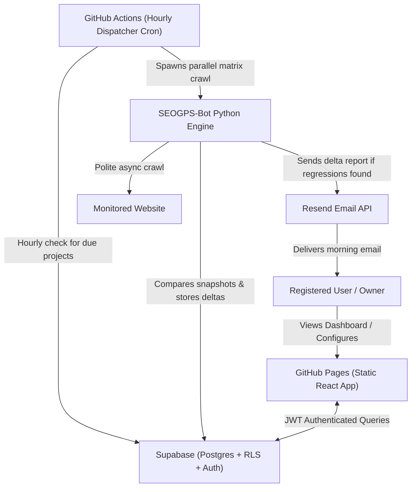
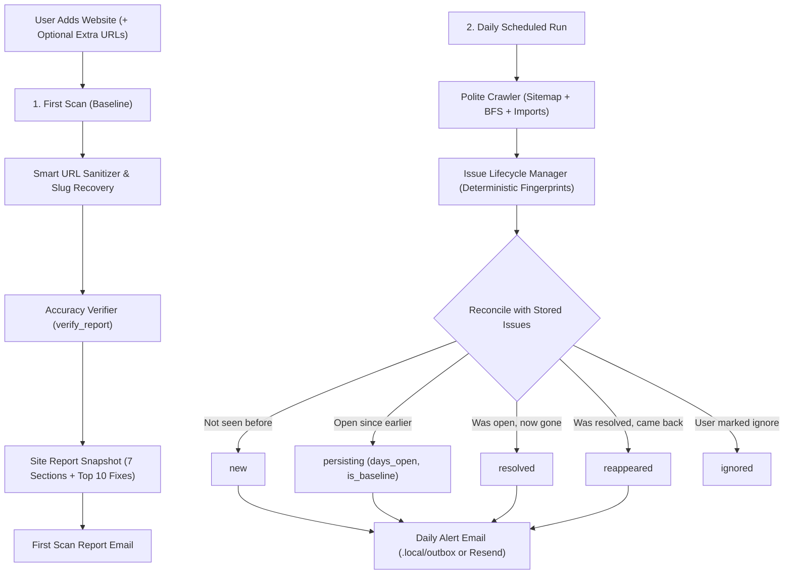
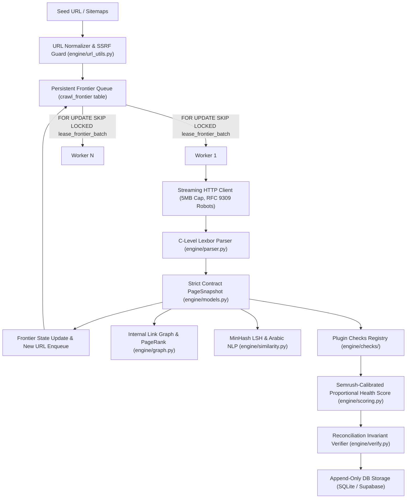

# SEO GPS: Architecture & Technical Specification

> **Created and Designed by Ismail El Asiouty**

---

## 1. Executive Summary

**SEO GPS** is a portfolio-grade, automated regression monitoring SaaS. It runs on a **Zero-Cost Hosting Architecture**, combining GitHub Actions, Supabase, GitHub Pages, and Resend.

---

## 2. Layer-by-Layer Tech Stack

| Component | Technology | Free Tier Budget |
|---|---|---|
| **Frontend** | React 18, Vite, TypeScript, Tailwind CSS | Unlimited bandwidth on GitHub Pages |
| **Scheduler** | GitHub Actions Hourly Cron (`0 * * * *`) | Unlimited minutes on Public GitHub Repos |
| **Detection Engine** | Python 3.11+ async (`httpx`, Jinja2, Pytest) | Runs inside GitHub Actions runners |
| **Analytics & Similarity** | R script (`stringdist`, Jaccard) + Python fallback | Runs inside runner environment |
| **Database & Auth** | Supabase (PostgreSQL 15 + RLS + GoTrue Auth) | 500 MB database, up to 50,000 MAU |
| **Email Delivery** | Resend API (or Brevo / SMTP) | 3,000 emails/month free tier |

---

## 4. First-Scan Baseline & Issue Lifecycle Architecture (v2.0)

### 4.1. Core Invariants & Accuracy Standards
1. **Reconciliation Invariant**: `total_discovered == total_crawled + total_skipped`. The sum of all status classifications equals `total_crawled`.
2. **Two-Step Confirmation**: Transient failures (404, 5xx, timeouts) re-request with browser User-Agent before recording.
3. **Structured Evidence**: Every finding stores exact requested URL, sanitized URL, response codes, hops, headers, timestamp, and source provenance.
4. **Deterministic Fingerprints**: SHA-256 hash of `check_id + normalized URL + problem attributes` ensuring idempotent reconciliation across scans.
5. **Local First Support**: SQLite database parity in `.local/seo_gps.db`, mock fixture server on `localhost:8099` (Day 1 baseline and Day 2 regression states), and `.local/outbox/` email persistence.

1. **Hourly Dispatcher**:
   - Fires every hour on GitHub Actions.
   - Evaluates: `daily_crawl_hour <= now (in user's timezone) AND last_run_at < today`.
   - Shards active projects into parallel matrix jobs.
2. **Polite Crawling**:
   - Reads `robots.txt` and XML sitemaps (including sitemap indexes and gzip archives).
   - Async crawling with per-host polite delays (250ms) and concurrency limits.
   - SSRF protection blocks private IP ranges and loopbacks.
3. **Deterministic Diffing**:
   - Pulls yesterday's snapshot.
   - Executes registered check plugins.
   - Compares: HTTP status transitions, canonical changes, robots meta, title/description modifications, and schema changes.
4. **Delta-Only Email**:
   - If deltas == 0, no email is sent (prevents notification fatigue).
   - If regressions exist, an email is dispatched containing the before vs after snapshot with direct dashboard links.

---

## 5. Semrush-Grade 1,000,000-Page Engine Architecture (v2.1)

### 5.1. Persistent Frontier & Distributed Sharding
- **Table & State Tracking**: Every discovered URL is persisted in `crawl_frontier` with state machine: `pending` -> `leased` -> `crawled` | `failed` | `skipped` | `blocked_by_robots`.
- **Atomic Worker Leasing**: Workers call `lease_frontier_batch(project_id, worker_id, batch_size)` leveraging PostgreSQL's `FOR UPDATE SKIP LOCKED` (with equivalent transaction handling in SQLite) guaranteeing zero double-crawls across concurrent workers.
- **Lease Heartbeat & Crash Recovery**: Leased batches carry a 10-minute expiry timestamp. If a worker dies or is preempted, expired leases return to `pending` automatically without data loss.

### 5.2. C-Level DOM Parsing & Canonical Normalization
- **Lexbor C-Parser**: Replaces slow and brittle regex/fallback parsers with `selectolax.lexbor.LexborHTMLParser`.
- **Tag & Comment Scrubbing**: Strips `<script>`, `<style>`, `<noscript>`, `<template>`, and raw HTML comments before extracting headings, titles, and body content.
- **Lossless Text Extraction**: Preserves raw quotes (`'` / `"`) in meta descriptions and titles, eliminating false regex truncation.
- **Soft 404 Heuristic**: Multi-signal detection evaluating title signatures ("404", "Not Found", "غير موجود", "الصفحة غير متاحة"), empty main containers (`<main>`, `#content`), and low non-navigational word counts.
- **SSRF & Normalization**: Strips tracking parameters (`utm_*`, `fbclid`, `gclid`), sorts query params, strips default ports (80/443), enforces RFC 3986 lowercase schemes/hosts, and filters loopback/private/metadata ranges.

### 5.3. Strict Data Contract (`engine/models.py`)
- Centralized `PageSnapshot` dataclass containing typed attributes:
  - `url`, `status_code`, `response_time_ms`, `crawl_status`, `content_type`
  - `title`, `meta_description`, `h1`, `h2`, `canonical_url`
  - `robots_directives` (noindex, nofollow, etc.)
  - `links_internal` (`List[LinkItem]`), `links_external` (`List[LinkItem]`)
  - `images` (`List[AssetItem]`), `hreflangs` (`List[HreflangEntry]`)
  - `redirect_chain` (`List[RedirectHop]`)
  - `json_ld_schemas`, `word_count`, `simhash`, `is_soft_404`, `pagerank`
- Backward compatibility accessors and serializable `.to_dict()` ensure seamless integration across all check plugins.

### 5.4. Scalable Similarity & Arabic NLP
- **Arabic Normalization**: Full Unicode normalization mapping Alef variations (`أ`, `إ`, `آ`) to `ا`, Taa Marbuta (`ة`) to `ه`, Yaa/Alif Maqsura (`ى`) to `ي`, removing diacritics (tashkeel), and stripping tatweel.
- **MinHash LSH Near-Duplicate Detection**: 64-permutation MinHash with 8 LSH bands enables $O(1)$ bucketing of near-duplicate pages without quadratic $O(n^2)$ comparisons.
- **Cannibalization Clusters**: Sparse TF-IDF matrices paired with scikit-learn `NearestNeighbors` (cosine metric) index large corpora efficiently.

### 5.5. Semrush-Calibrated Health Score & PageRank
- **Proportional Penalty Calculation**:
  $$\text{penalty} = \min\left(3.5, \; \text{weight} \times \left(1.0 + \log_{10}\left(1 + \frac{\text{affected}}{\text{total}} \times 9\right)\right)\right)$$
  where weights are `critical: 1.0`, `warning: 0.35`, and `notice: 0.08`.
- **Link Equity PageRank**: Standard 20-iteration power iteration with damping factor $\alpha = 0.85$ scaled to [0, 100] provides deep page visibility and orphan identification.

### 5.6. Zero-Fabrication Integrity & Invariants
- **Global Reconciliation**:
  $$\text{total\_discovered} = \text{total\_crawled} + \text{total\_skipped} + \text{blocked\_by\_robots} + \text{total\_failed} + \text{total\_pending}$$
- **Honest Cataloging**: Discovered but un-crawled URLs are flagged with `crawl_status: "discovered_not_crawled"`, `statusCode: 0`, `wordCount: 0`, and `schemas: []`.
- **Transparent Truncation**: Crawls capped by quota/time constraints emit `truncated: true` and surface representative sample banners in UI and reports.
