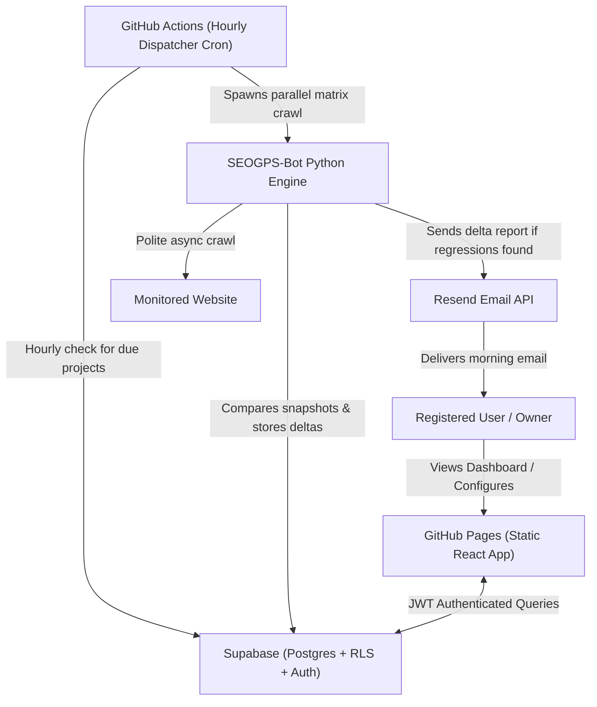

# SEO GPS: Architecture & Technical Specification

> **Created and Designed by Ismail El Asiouty**

---

## 1. Executive Summary

**SEO GPS** is a portfolio-grade, automated regression monitoring SaaS. It runs on a **Zero-Cost Hosting Architecture**, combining GitHub Actions, Supabase, GitHub Pages, and Resend.

---

## 2. Layer-by-Layer Tech Stack

| Component | Technology | Free Tier Budget |
|---|---|---|
| **Frontend** | React 18, Vite, TypeScript, Tailwind CSS | Unlimited bandwidth on GitHub Pages |
| **Scheduler** | GitHub Actions Hourly Cron (`0 * * * *`) | Unlimited minutes on Public GitHub Repos |
| **Detection Engine** | Python 3.11+ async (`httpx`, Jinja2, Pytest) | Runs inside GitHub Actions runners |
| **Analytics & Similarity** | R script (`stringdist`, Jaccard) + Python fallback | Runs inside runner environment |
| **Database & Auth** | Supabase (PostgreSQL 15 + RLS + GoTrue Auth) | 500 MB database, up to 50,000 MAU |
| **Email Delivery** | Resend API (or Brevo / SMTP) | 3,000 emails/month free tier |

---

## 3. Data Flow & Delta-Only Alerting

1. **Hourly Dispatcher**:
   - Fires every hour on GitHub Actions.
   - Evaluates: `daily_crawl_hour <= now (in user's timezone) AND last_run_at < today`.
   - Shards active projects into parallel matrix jobs.
2. **Polite Crawling**:
   - Reads `robots.txt` and XML sitemaps (including sitemap indexes and gzip archives).
   - Async crawling with per-host polite delays (250ms) and concurrency limits.
   - SSRF protection blocks private IP ranges and loopbacks.
3. **Deterministic Diffing**:
   - Pulls yesterday's snapshot.
   - Executes registered check plugins.
   - Compares: HTTP status transitions, canonical changes, robots meta, title/description modifications, and schema changes.
4. **Delta-Only Email**:
   - If deltas == 0, no email is sent (prevents notification fatigue).
   - If regressions exist, an email is dispatched containing the before vs after snapshot with direct dashboard links.
